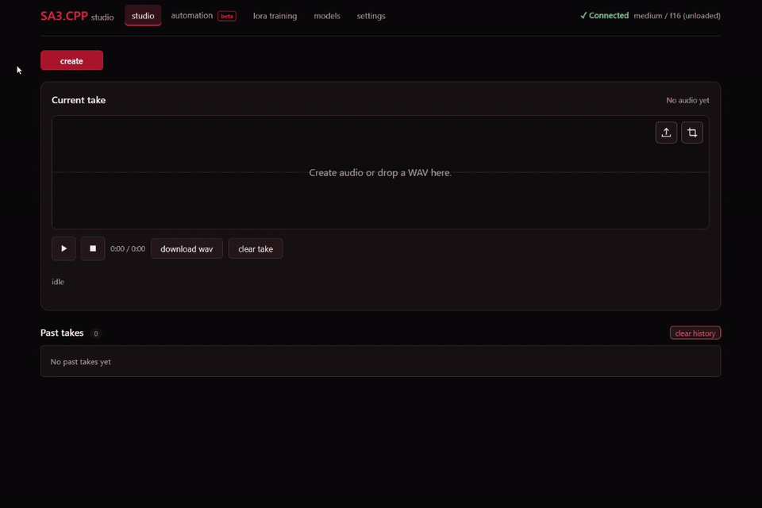

# sa3.cpp

this repo began as a ggml implemention of stable-audio-3. now it supports every stable audio model, and includes native lora training. my main focus has been embedded applications using the c abi, but there is also a cli and web ui you can use to train loras and generate audio with.

**10/18/2026 update:** there's a new experimental Automation tab in the web ui where you can
draw envelopes for individual LoRA strengths to control a generation over time.
Expect it to change rapidly as we figure out the workflow. See the [automation guide](docs/SERVER.md#lora-automation-lanes-lora_lanes-lora_envelope) for the current primitives and options.

## built with sa3.cpp

these applications run sa3.cpp outside this repository:

| Application | What it uses | Download |
|---|---|---|
| [foundation keys](https://github.com/betweentwomidnights/foundation-1.2-iplug2) | Foundation-1.2 Keybeds text-to-synth through the Stable Audio Tools backend | [v0.1.2 for Windows and macOS](https://github.com/betweentwomidnights/foundation-1.2-iplug2/releases/tag/v0.1.2) |
| [sa3 iPlug2 demo](https://github.com/betweentwomidnights/sa3.cpp-iplug2-demo) | Stable Audio 3 VST3 and REAPER extension using the embedded C ABI | [v0.4.0 for Windows](https://github.com/betweentwomidnights/sa3.cpp-iplug2-demo/releases/tag/v0.4.0) |
| [sa3 ableton extension](https://github.com/betweentwomidnights/sa3-ableton-extension) | Stable Audio 3 inside Ableton Live using the embedded C ABI | [v0.2.0 prerelease for Windows](https://github.com/betweentwomidnights/sa3-ableton-extension/releases/tag/v0.2.0) |
| [gary4local](https://github.com/betweentwomidnights/gary-localhost-installer) + [gary4juce](https://github.com/betweentwomidnights/gary4juce) | saos, sa3, and foundation-1 services using the sa3.cpp servers, connected to the daw with gary4juce | [installer and setup](https://github.com/betweentwomidnights/gary-localhost-installer) |
| [sa3.cpp iOS](https://github.com/betweentwomidnights/sa3.cpp-ios) | Experimental on-device LoRA training and inference on an iPhone 13 | [source and build instructions](https://github.com/betweentwomidnights/sa3.cpp-ios) (no release yet) |

## browser studio



in the web ui:

- **studio** — create, transform, and continue audio, with or without LoRAs.
- **lora training** — train a LoRA directly in your browser.
- **automation (beta)** — experiment with adjusting the strength of individual
  LoRAs over the course of a generation.

the models and settings tabs handle model downloads, decoder corrections, and audio output
preferences.

After the build and model download below, run `server.cmd` on Windows to start the
inference studio at [127.0.0.1:8006](http://127.0.0.1:8006):

```powershell
.\server.cmd
```

Use `.\studio.cmd` instead to start **both inference and LoRA training** behind
the same browser URL. On macOS/Linux, use `./server.sh --port 8006` for inference;
the [server guide](docs/SERVER.md) covers starting the training companion.

## quickstart

you'll need CMake and a C++17 compiler. CUDA builds also need the CUDA Toolkit;
Vulkan builds need the Vulkan SDK. see the [build guide](docs/CLI.md#build-and-backends)
for platform details.

```bash
git clone --recurse-submodules https://github.com/betweentwomidnights/sa3.cpp.git
cd sa3.cpp
```

### windows (PowerShell)

```powershell
.\build.cmd cuda
.\models.cmd
. .\env.ps1
sa3-generate --model medium --duration 30 --prompt "upbeat funk groove with slap bass" --out song.wav
```

### macOS / linux

```bash
./build.sh cuda        # use metal on macOS, or vulkan / cpu
./models.sh
source ./env.sh
sa3-generate --model medium --duration 30 --prompt "upbeat funk groove with slap bass" --out song.wav
```

the model download defaults to **medium**. to try a smaller music model, download
with `models.cmd --variant small-music` (or `./models.sh --variant small-music`)
and generate with `--model small-music`.

already have a GGUF adapter in your models folder? Add `--lora NAME` to your
generation command. For native training, download the matching base with
`models.cmd --training-base` (or `./models.sh --training-base`), then run:

```bash
sa3-train --dataset /path/to/dataset --steps 1500
```

see [CLI examples](docs/CLI.md) for adapters, transformations, and continuations,
and the [training guide](docs/TRAINING.md) for dataset preparation.

## docs

- [CLI usage and configuration](docs/CLI.md) · [Server and HTTP API](docs/SERVER.md)
- [LoRA training](docs/TRAINING.md) · [Training web UI](docs/TRAINING_WEB.md)
- [Embedding and C ABI](docs/EMBEDDING.md) · [Runtime packaging](docs/RUNTIME_RELEASE.md)
- [Stable Audio Open Small](docs/STABLE_AUDIO_OPEN_SMALL.md) · [Stable Audio Open 1.0 and Foundation-1](docs/STABLE_AUDIO_OPEN_1.md) · [SAT server](docs/SAT_SERVER.md)
- [Generation benchmarks](docs/BENCHMARKS.md) · [Training benchmarks](docs/TRAINING_BENCHMARKS.md)
- [Vulkan](docs/VULKAN.md) · [Metal](docs/METAL.md) · [HIP/ROCm](docs/HIP.md)
- [Model weights and distribution](docs/DISTRIBUTION.md) · [Updating the ggml submodule](docs/GGML_FORK.md#updating-existing-clones-and-downstream-forks)

## credits and references

some shoutouts:

- [Bakobiibizo](https://github.com/Bakobiibizo) — LoRA training work.
- [tinycrops](https://github.com/tinycrops) — LoRA automation lanes.
- [pillopaus-project](https://github.com/pillopaus-project) — the web interface.

[Stability AI's Stable Audio 3](https://github.com/Stability-AI/stable-audio-3) and
[stable-audio-tools](https://github.com/Stability-AI/stable-audio-tools) provide the
reference implementations. The [RoyalCities Foundation fork](https://github.com/RoyalCities/RC-stable-audio-tools)
and [Foundation-1 model card](https://huggingface.co/RoyalCities/Foundation-1)
document the Foundation inference path.

[dada-bots/underfit](https://github.com/dada-bots/underfit) informed the native LoRA
and DoRA training path; [acestep.cpp](https://github.com/ServeurpersoCom/acestep.cpp)
was another useful C++ reference.

License: [MIT](LICENSE). Model weights have their own licenses; see their model cards.
